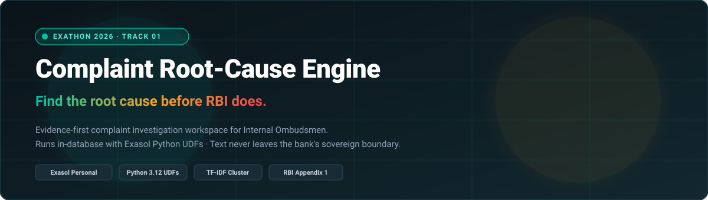
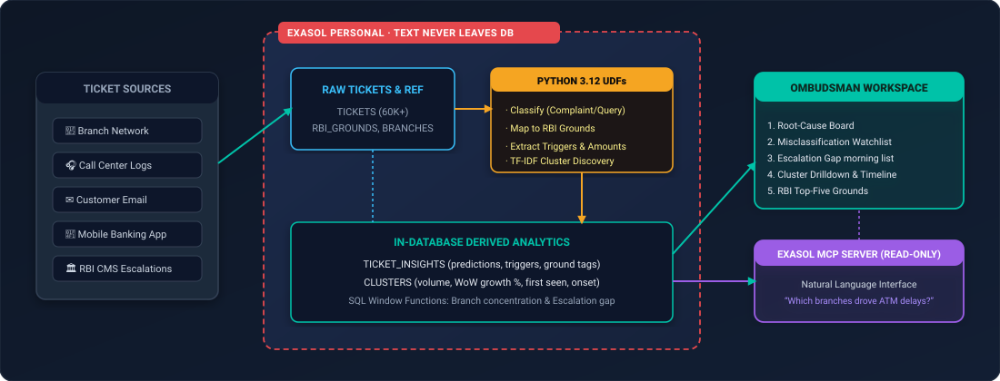
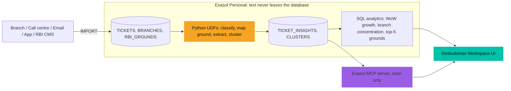

<div align="center">




<p align="center">
  
  
  
  
  
</p>


</div>


<p align="center">
  
  
  
</p>

<p align="center">
  <a href="https://altas-resolve.vercel.app" target="_blank"></a>
  <a href="https://backend-three-liard-60.vercel.app/health" target="_blank"></a>
  <a href="./docs/Catching_Ghost_Complaints_Before_RBI_Does.mp4"></a>
  <a href="./docs/Sovereign_Complaint_Engine.pdf"></a>
</p>


## Live Deployments

| Component | Production URL | Status | Description |
|---|---|---|---|
| **Web Application** | [https://altas-resolve.vercel.app](https://altas-resolve.vercel.app) |  | Evidence-first Internal Ombudsman workspace |
| **Backend API** | [https://backend-three-liard-60.vercel.app](https://backend-three-liard-60.vercel.app) |  | Real-time classification & root-cause clustering API |
| **API Health Check** | [https://backend-three-liard-60.vercel.app/health](https://backend-three-liard-60.vercel.app/health) |  | Uptime & data backend check |
| **Secondary Mirror** | [https://exathon-web.vercel.app](https://exathon-web.vercel.app) |  | Production alias mirror |


## Problem Statement

> The internal ombudsman at a mid-size bank receives thousands of complaints a month across branches, call centres, email and the app, each tagged by whoever logged it. She can't tell which ones were wrongly closed as "queries", or which single process failure is generating hundreds of complaints, because the categories are inconsistent and the reasons are buried in free text. If this worked, she'd see the three root causes driving most complaints before RBI's review does, and fix the process instead of answering the same complaint 500 times.

**Why it matters**

* **The regulator is calling it out.** The RBI Governor flagged banks misclassifying complaints as "customer queries" and rejected grievances not reaching the internal ombudsman.
* **Banks miss problems until RBI sees them.** Many issues are only sorted at the ombudsman stage, and RBI has asked banks for root-cause analysis.
* **Volume is rising.** Complaints under RBI's ombudsman scheme reached 13.34 lakh in FY 2024-25, up 13.55%.
* **There is a compliance hook.** Banks must disclose their top five complaint grounds using RBI's master list.

<table>
<tr>
<td width="50%" align="center">

### Today: agent tags
```yaml
Source of truth:   whoever logged the ticket
Misclassified:     complaints closed as "query"
Escalation:        rejections never reach the IO
Root cause:        buried in free text
RBI disclosure:    built from inconsistent tags
```

</td>
<td width="50%" align="center">

### With the engine: the text
```yaml
Source of truth:   every ticket's own words
Misclassified:     flagged, with confidence + phrase
Escalation:        gap listed every morning
Root cause:        ranked clusters with start date
RBI disclosure:    top-five grounds, re-classified
```

</td>
</tr>
</table>

> **The one-line pitch** (illustrative numbers from our synthetic data): agent tags say the bank had 400 complaints last month; the text says it had 1,100, and 600 of them come from one broken UPI reversal process.


## Live Architecture

<div align="center">

</div>

<div align="center">
<details>
<summary>Click the arrow to view the Mermaid diagram &nbsp;</summary>



</details>
</div>


## Tech Stack

<table align="center">
<tr>
<td width="33%" align="center">

**Database & Compute**


<br/>


</td>
<td width="33%" align="center">

**Text Engine**


<br/>


</td>
<td width="33%" align="center">

**App & Access**


<br/>


</td>
</tr>
</table>


## Core Capabilities

Six screens, built for one user: the bank's **Internal Ombudsman** (or Principal Nodal Officer). Every morning they answer three questions: *what was misclassified, what was wrongly rejected, and which root causes drive the volume?*

<table>
<tr>
<td width="33%" valign="top">

### 1. Root-cause board
* Top complaint clusters ranked by **volume** and **week-on-week growth**
* Each mapped to an **RBI complaint ground**
* The three causes driving most complaints, at a glance

</td>
<td width="33%" valign="top">

### 2. Misclassification watchlist
* Tickets closed as **"query"** or **"request"** whose text reads as a complaint
* **Confidence score** per ticket
* The **trigger phrase** highlighted

</td>
<td width="33%" valign="top">

### 3. Escalation gap
* Rejected or partly resolved complaints
* That **never reached the internal ombudsman**
* The second issue RBI flagged

</td>
</tr>
<tr>
<td width="33%" valign="top">

### 4. Cluster drill-down
* Sample tickets, affected **branches, channels, products**
* **Daily timeline** showing when the spike started
* Turns a cluster into a fixable process failure

</td>
<td width="33%" valign="top">

### 5. Top-five grounds draft
* The **annual-report disclosure table**
* Generated from re-classified text, not agent tags
* Before vs after, side by side

</td>
<td width="33%" valign="top">

### 6. Ask the data
* Plain-English questions via **Exasol's MCP server**
* **Read-only** by design
* *"Which branches drove the ATM-debit cluster last week?"*

</td>
</tr>
</table>


## Comparison

<table align="center">
<tr>
<th>Metric</th>
<th>Tag-based complaint tracking</th>
<th>Complaint Root-Cause Engine</th>
<th>Result</th>
</tr>
<tr>
<td><strong>Complaint vs query</strong></td>
<td>Whatever the agent picked</td>
<td>Classified from the ticket's own text</td>
<td>Hidden complaints surface</td>
</tr>
<tr>
<td><strong>Root cause</strong></td>
<td>Manual reading, sampling</td>
<td>Clusters ranked by volume and growth</td>
<td>One broken process, found in one view</td>
</tr>
<tr>
<td><strong>Escalation to IO</strong></td>
<td>Audited after the fact</td>
<td>Gap listed every morning</td>
<td>Fixed before RBI's review</td>
</tr>
<tr>
<td><strong>Data residency</strong></td>
<td>Text exported to external tools</td>
<td>All analysis runs as UDFs inside Exasol</td>
<td>Ticket text never leaves the bank's database</td>
</tr>
<tr>
<td><strong>RBI top-five disclosure</strong></td>
<td>Built from inconsistent tags</td>
<td>Built from re-classified data</td>
<td>Direct compliance output</td>
</tr>
</table>


## Data

| Dataset | What it is | Why we use it |
|---|---|---|
| **A. Bharat Co-operative Bank** (synthetic) | ~60,000 tickets over 6 months, 5 channels, 40 branches across 6 states; a 2M-row copy for the scale test | Planted problems, so we know the right answers |
| **B. CFPB Consumer Complaint Database** (public) | ~50,000 consumer-written narratives: checking accounts, credit cards, money transfers | Proves the text engine works on genuine human writing; CFPB's product/issue fields act as labels |

The synthetic category mix is calibrated to RBI's FY 2024-25 ombudsman data (loans 29.25%, credit cards 17.15%, mobile banking 16.86%, deposit accounts 16.84%). Text is in Indian English, written from templates plus LLM paraphrases so no two tickets read alike.

**Planted patterns the engine must find (ground truth)**

1. UPI reversal delays spike at 8 branches after a dated core-banking change; 35% are logged as "query".
2. ATM cash not dispensed but account debited, concentrated on one ATM vendor.
3. New SMS-alert and minimum-balance charges after a policy change, mostly tagged "request".
4. Loan interest reset not communicated: the largest cluster, matching loans as RBI's top category.
5. Rejected complaints never escalated to the internal ombudsman: 12% of rejections.
6. Noise: genuine queries (balance, branch timings, cheque book status) that must stay queries.

**Tables**

| Table | Key columns | Written by |
|---|---|---|
| `TICKETS` | ticket_id, received_at, channel, branch_id, product, agent_category, agent_type, resolution, escalated_to_io, closed_at, text | Raw input, as agents logged it |
| `BRANCHES` | branch_id, city, state, region | Dimension |
| `RBI_GROUNDS` | ground_code, ground_name | Transcribed from Appendix 1 of RBI's grievance circular |
| `TICKET_INSIGHTS` | ticket_id, is_complaint_pred, confidence, trigger_phrase, ground_pred, cluster_id, amount, txn_ref, entities | Our UDFs |
| `CLUSTERS` | cluster_id, label, size, wow_growth, first_seen, top_branches | Root-cause job |
| `GROUND_TRUTH` | ticket_id, true_type, true_pattern | Kept separate; used only to score accuracy |

> **Data note:** synthetic Indian bank data plus public US CFPB data only. No employer or real customer data is used anywhere in this repo.


## Setup & Installation

**Prerequisites:** Python 3.12, the Exasol CLI, and Exasol Personal (installed separately; see the licence note below).

```bash
# 1. Clone
git clone https://github.com/susin-d/ExaThon.git
cd ExaThon

# 2. Install Exasol Personal locally
exasol install local

# 3. Install the Python script language container
#    (local deployments ship without one)
exasol slc install python3

# 4. Python environment
python3.12 -m venv .venv
source .venv/bin/activate          # Windows: .venv\Scripts\activate
pip install -r requirements.txt

# 5. Connection settings
cp .env.example .env               # set EXA_DSN, EXA_USER, EXA_PASSWORD
```


## Run Guide

Run these in order. Each step ends with something you can check.

```bash
# 1. Create the schema and generate the synthetic bank
python scripts/generate_synthetic.py      # -> data/tickets.csv, branches.csv

# 2. Bulk-load everything with IMPORT (tickets, branches, RBI grounds, CFPB)
python scripts/load_data.py

# 3. Deploy the Python UDFs into Exasol
python scripts/deploy_udfs.py

# 4. Run the text pipeline in-database (classify, map ground, extract, cluster)
python scripts/run_pipeline.py            # fills TICKET_INSIGHTS and CLUSTERS

# 5. Start the app
# Local development mode
npm run dev --prefix frontend             # opens http://localhost:5173
```

**Check it worked:** how many "queries" are really complaints?

```sql
SELECT t.agent_type,
       COUNT(*)                                            AS tickets,
       SUM(CASE WHEN i.is_complaint_pred THEN 1 ELSE 0 END) AS complaints_by_text
FROM   TICKETS t
JOIN   TICKET_INSIGHTS i ON i.ticket_id = t.ticket_id
GROUP  BY t.agent_type;
```

**Optional, Ask the data:** connect Exasol's [MCP server](https://github.com/exasol/mcp-server) to your MCP client with a read-only user, then ask questions such as *"Which rejected complaints never reached the internal ombudsman?"*


## Usage & Demo Walkthrough

| Step | Action |
|---|---|
| 1 | Open the app at `https://altas-resolve.vercel.app` (or local `localhost:5173`) |
| 2 | **Root-cause board:** the UPI reversal cluster ranks near the top, with its start date and 8 branches |
| 3 | Click it for the **cluster drill-down:** daily timeline, branches, channels, sample tickets |
| 4 | **Misclassification watchlist:** open a ticket tagged "query" and see the highlighted trigger phrase |
| 5 | **Escalation gap:** rejected complaints that never reached the internal ombudsman |
| 6 | **Top-five grounds draft:** agent tags vs re-classified text, side by side |
| 7 | **Ask the data:** type a plain-English question, answered read-only through MCP |


## Accuracy

| Test | Dataset | Result |
|---|---|---|
| Complaint vs query classification | Synthetic, scored against `GROUND_TRUTH` | `__%` |
| Planted patterns recovered in top clusters | Synthetic | `__ / 5` |
| Ground / issue classification | CFPB, 50,000 real narratives | `__%` |
| UDF pipeline runtime | 60,000 tickets / 2M rows | `__ s / __ s` |

CFPB accuracy is the headline number: synthetic text is easier, so we report real human writing first.


<details>
<summary><strong>Q&A</strong></summary>

**Q1: Why Exasol instead of a Python script?**
> Ticket text is sensitive customer data. Every step runs as a Python UDF inside Exasol, in parallel across the data and called from plain SQL, so the text never leaves the bank's database. The analytics (week-on-week growth, branch concentration, top-five grounds) are SQL window functions on the same data, and the MCP server gives plain-English, read-only access without exporting anything.

**Q2: How accurate is it?**
> See the Accuracy table. We validate on 50,000 real CFPB complaints, where CFPB's own product and issue fields act as labels, and score the synthetic data against a separate ground-truth table the engine never sees.

**Q3: How does it scale to a large bank?**
> UDFs run in parallel inside Exasol, so the same SQL call covers 60,000 tickets or millions. We ran a 2-million-row copy for the scale test.

**Q4: What about Hinglish or regional languages?**
> Out of scope for this build: the engine handles English text. Multilingual support is first on the roadmap.

**Q5: Isn't this just complaint tracking?**
> Tracking counts tags. This reads the text, so it finds complaints hidden as queries, rejections that skipped the ombudsman, and the single process failure behind a spike.

</details>


## Roadmap

1. **Hindi and regional languages**, including Hinglish ticket text
2. **Exasol Text AI** for in-database entity recognition and information extraction
3. **Live CRM integration** instead of batch loads
4. **User logins and roles** for branch heads, nodal officers and the IO
5. **Morning alerts** when a cluster's week-on-week growth crosses a threshold

## Licence

Our code is released under the **MIT License** (see [`LICENSE`](./LICENSE)).

Exasol Personal and Exasol Text AI are proprietary products, installed separately and covered by Exasol's own terms. Only the code in this repository is MIT-licensed. The CFPB Consumer Complaint Database is a public US government dataset.


<div align="center">


<sub><strong>Event:</strong> ExaThon 2026 &nbsp;|&nbsp; <strong>Track:</strong> 01 Money, Risk &amp; Regulation &nbsp;|&nbsp; <strong>Team:</strong> ExaThon</sub>
<br/>
<sub>Repo: susin-d/ExaThon</sub>

</div>
